# IOTIQ Partner ERP — Proposed PostgreSQL ER Diagram

> Proposed production relational schema based on the standalone HTML application. Validate against the source and SRS before creating migrations.

```mermaid
erDiagram
    USERS {
        uuid id PK
        varchar full_name
        varchar email UK
        varchar password_hash
        varchar status
        timestamp created_at
    }
    ROLES {
        uuid id PK
        varchar name UK
        varchar description
    }
    USER_ROLES {
        uuid user_id FK
        uuid role_id FK
    }
    PARTNER_TIERS {
        uuid id PK
        int tier_level
        varchar name
        decimal commission_percent
        decimal minimum_revenue
        int payout_days
    }
    PARTNERS {
        uuid id PK
        uuid tier_id FK
        varchar partner_code UK
        varchar name
        varchar category
        varchar contact_name
        varchar email
        varchar phone
        varchar gstin
        varchar pan
        varchar status
        varchar agreement_status
        boolean strategic_programme
        boolean downgrade_grace
        timestamp created_at
    }
    LEADS {
        uuid id PK
        uuid partner_id FK
        uuid created_by FK
        varchar lead_number UK
        varchar client_name
        varchar client_phone
        varchar client_email
        varchar project_type
        decimal budget
        varchar stage
        timestamp acknowledged_at
        date protection_until
        timestamp created_at
    }
    PRODUCTS {
        uuid id PK
        varchar sku UK
        varchar category
        varchar partner_name
        varchar b2c_name
        varchar hsn
        decimal gst_percent
        decimal partner_price
        decimal b2c_price
        decimal cost_price
        boolean active
    }
    ESTIMATES {
        uuid id PK
        uuid partner_id FK
        uuid lead_id FK
        varchar estimate_number UK
        date estimate_date
        date valid_until
        varchar status
        decimal discount_percent
        decimal subtotal
        decimal gst_amount
        decimal grand_total
    }
    ESTIMATE_ITEMS {
        uuid id PK
        uuid estimate_id FK
        uuid product_id FK
        varchar description
        decimal quantity
        decimal unit_price
        decimal b2c_unit_price
        decimal gst_percent
        decimal line_total
    }
    INVOICES {
        uuid id PK
        uuid partner_id FK
        uuid lead_id FK
        uuid estimate_id FK
        varchar invoice_number UK
        date invoice_date
        date due_date
        varchar status
        decimal subtotal
        decimal gst_amount
        decimal grand_total
    }
    INVOICE_ITEMS {
        uuid id PK
        uuid invoice_id FK
        uuid product_id FK
        varchar description
        decimal quantity
        decimal unit_price
        decimal b2c_unit_price
        decimal gst_percent
        decimal line_total
    }
    PAYMENTS {
        uuid id PK
        uuid invoice_id FK
        uuid partner_id FK
        date payment_date
        decimal amount
        decimal net_amount
        varchar payment_method
        varchar reference_number
        varchar payment_type
    }
    PARTNER_PAYOUTS {
        uuid id PK
        uuid partner_id FK
        uuid payment_id FK
        decimal commission_percent
        decimal gross_commission
        decimal tds_amount
        decimal net_payout
        date due_date
        date paid_date
        varchar status
    }
    B2C_DOCUMENTS {
        uuid id PK
        uuid partner_id FK
        uuid estimate_id FK
        uuid invoice_id FK
        varchar internal_number UK
        varchar document_type
        decimal partner_total
        decimal b2c_total
        decimal price_difference
        timestamp created_at
    }
    B2C_DOCUMENT_ITEMS {
        uuid id PK
        uuid b2c_document_id FK
        uuid product_id FK
        varchar description
        decimal quantity
        decimal unit_price
        decimal gst_percent
    }
    COMPANY_SETTINGS {
        uuid id PK
        varchar company_name
        varchar gstin
        varchar email
        varchar phone
        int lead_protection_days
        int acknowledgement_hours
        int estimate_sla_days
        int invoice_due_days
        decimal tds_percent
        decimal tds_threshold
    }
    AUDIT_LOGS {
        uuid id PK
        uuid user_id FK
        varchar entity_type
        uuid entity_id
        varchar action
        jsonb old_values
        jsonb new_values
        timestamp created_at
    }

    USERS ||--o{ USER_ROLES : assigned
    ROLES ||--o{ USER_ROLES : contains
    PARTNER_TIERS ||--o{ PARTNERS : classifies
    PARTNERS ||--o{ LEADS : registers
    USERS ||--o{ LEADS : creates
    PARTNERS ||--o{ ESTIMATES : receives
    LEADS |o--o{ ESTIMATES : generates
    ESTIMATES ||--|{ ESTIMATE_ITEMS : contains
    PRODUCTS ||--o{ ESTIMATE_ITEMS : referenced_by
    PARTNERS ||--o{ INVOICES : receives
    LEADS |o--o{ INVOICES : generates
    ESTIMATES |o--o{ INVOICES : converted_to
    INVOICES ||--|{ INVOICE_ITEMS : contains
    PRODUCTS ||--o{ INVOICE_ITEMS : referenced_by
    INVOICES ||--o{ PAYMENTS : receives
    PARTNERS ||--o{ PAYMENTS : associated_with
    PARTNERS ||--o{ PARTNER_PAYOUTS : earns
    PAYMENTS ||--o{ PARTNER_PAYOUTS : generates
    PARTNERS ||--o{ B2C_DOCUMENTS : associated_with
    ESTIMATES |o--o| B2C_DOCUMENTS : internal_copy
    INVOICES |o--o| B2C_DOCUMENTS : internal_copy
    B2C_DOCUMENTS ||--|{ B2C_DOCUMENT_ITEMS : contains
    PRODUCTS ||--o{ B2C_DOCUMENT_ITEMS : referenced_by
    USERS ||--o{ AUDIT_LOGS : performs
```

## Notes
- The source HTML uses browser storage, not these SQL tables; this is a proposed production model.
- Use `NUMERIC` for money and snapshot item prices in document lines.
- Restrict internal B2C data at the API and database authorization layers.
- Validate nullable relationships, payment reversals, and payout accounting before migrations.
